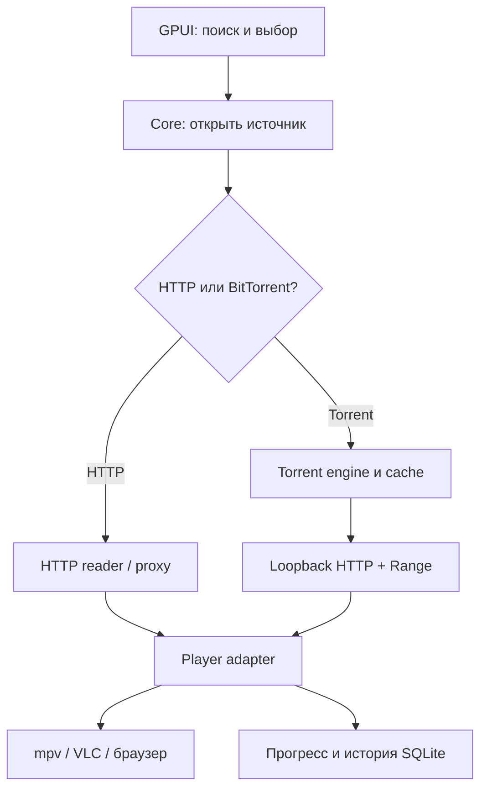

# kadr — техническое задание v1.0

**Статус:** согласованная продуктовая спецификация MVP; технические реализации, отмеченные как *кандидат*, подлежат проверке прототипом.  
**Дата:** 13 ноября 2026 года.  
**Платформы:** Linux (Wayland/X11) и macOS.  
**Язык и UI:** Rust, GPUI.

## 1. Назначение

**kadr** — локальное desktop-приложение для поиска фильмов и сериалов, получения доступных источников видео и потокового воспроизведения через установленный внешний плеер. Поддерживаемые входы: HTTP(S)-ссылка, magnet-ссылка, файл `.torrent`. Приложение не требует учётной записи или собственного удалённого backend-сервера.

Ключевой сценарий: пользователь находит фильм или серию в каталоге, выбирает доступный источник, начинает смотреть в mpv/VLC (либо в браузере, если формат поддерживается), закрывает плеер и впоследствии продолжает просмотр с сохранённого места.

Приложение не гарантирует наличие источника для каждого фильма. Метаданные каталога и источники видео — независимые сущности. Пользователь несёт ответственность за права на просмотр и распространение контента; BitTorrent может раздавать полученные части другим участникам сети.

## 2. Обязательные продуктовые решения

| ID | Область | Решение |
|---|---|---|
| D-01 | Название | `kadr` |
| D-02 | UI | Нативный GPUI на Rust, без Electron |
| D-03 | Платформы | Linux и macOS; Windows не является целью v1.0 |
| D-04 | Каталог | Полноценные метаданные фильмов/сериалов, поиск и поиск доступных источников; **без** рекомендаций и подборок |
| D-05 | Источники | HTTP(S), magnet, `.torrent` |
| D-06 | Торренты | Просмотр до полной загрузки, сохранение файла по желанию |
| D-07 | Сериалы | Автоматическое распознавание сезонов и эпизодов по файлам |
| D-08 | Звук/субтитры | Выбираются средствами внешнего плеера |
| D-09 | Прогресс | Автоматическое отслеживание и возобновление там, где плеер предоставляет управление/телеметрию |
| D-10 | Хранилище | SQLite и ограниченный локальный кэш с автоматической очисткой |
| D-11 | Выпуск | Linux-пакеты и macOS `.dmg` |
| D-12 | Не входят в v1.0 | Плагины, аккаунты, облачная синхронизация, встроенный GPUI-плеер, персональные рекомендации |

## 3. Границы MVP

Уровни приоритета: **MUST** — условие приёмки v1.0, **SHOULD** — желательно при достаточном времени, **LATER** — вне v1.0.

### 3.1 Каталог и библиотека

| ID | Приоритет | Требование |
|---|---|---|
| CAT-01 | MUST | Поиск фильмов и сериалов по названию; отображение состояний загрузки, пустого результата и ошибки |
| CAT-02 | MUST | Карточка: название, оригинальное название при наличии, год, описание, постер, тип произведения; для сериала — сезоны и эпизоды |
| CAT-03 | MUST | Поиск источников для выбранного произведения через встроенные явно настроенные адаптеры источников; результат показывает тип и доступные сведения о качестве/языке, если они известны |
| CAT-04 | MUST | Ручной ввод HTTP(S)/magnet и открытие `.torrent` как альтернативный путь, в том числе когда автоматический поиск ничего не нашёл |
| CAT-05 | MUST | Локальная библиотека: избранное, история запусков, ранее просматриваемые произведения |
| CAT-06 | MUST | Возможность связать открытый вручную источник с записью каталога; также допускается просмотр без такой связи |
| CAT-07 | SHOULD | Кэшировать ранее полученные метаданные и постеры для ускорения повторного открытия |
| CAT-08 | LATER | Рекомендации, подборки, персональная лента, социальные функции |

**Граница поиска источников:** в MVP не проектируется универсальный поисковик по всему интернету и не вводится плагинная система. Для каждого подключаемого встроенного источника требуется документированный законный способ получения данных, явная конфигурация и обработка недоступности. Конкретные источники/сервисы и их API ещё **не утверждены**; до выбора интеграций допустим демонстрационный адаптер с тестовыми или свободно распространяемыми материалами. MVP не считается завершённым, пока хотя бы один реальный разрешённый адаптер поиска источников не работает end-to-end.

### 3.2 Воспроизведение

| ID | Приоритет | Требование |
|---|---|---|
| PLAY-01 | MUST | Открытие HTTP(S)-видео через внешний плеер напрямую либо через локальный прокси, если это требуется |
| PLAY-02 | MUST | Просмотр magnet/`.torrent` без ожидания полного скачивания; буферизация с приоритетом необходимых частей |
| PLAY-03 | MUST | Отображение стадии: получение метаданных, подключение к пирам, буферизация, готовность, воспроизведение, ошибка |
| PLAY-04 | MUST | Выбор видеофайла в многофайловом торренте, включая сериалы |
| PLAY-05 | MUST | Запуск mpv и VLC; обнаружение установленного плеера и понятная ошибка при его отсутствии |
| PLAY-06 | MUST | Открытие локального HTTP-адреса в системном браузере с явным предупреждением о неподдерживаемых контейнерах/кодеках |
| PLAY-07 | MUST | Выбор плеера по умолчанию и команда «Открыть в…»; переключение плеера не запускает повторную загрузку исходных данных |
| PLAY-08 | MUST | Перемотка поддерживаемым плеером посредством HTTP Range с перестройкой приоритетов торрент-загрузки |
| PLAY-09 | MUST | Автоматически сохранять позицию для управляемых сессий mpv/VLC и восстанавливать её при повторном запуске; не обещать телеметрию от произвольного браузера |
| PLAY-10 | MUST | Аудиодорожки и субтитры выбираются средствами плеера; kadr не реализует отдельный UI выбора дорожек |
| PLAY-11 | SHOULD | Предлагать переход к следующему распознанному эпизоду после окончания текущего |
| PLAY-12 | LATER | Встроенный видеоплеер, транскодирование, Chromecast/AirPlay |

**Управление mpv/VLC:** адаптер плеера должен уметь запускать процесс, получать позицию и длительность (если они доступны), определять завершение и передавать начальную позицию. Техническая схема IPC/mpv и управления VLC уточняется отдельными интеграционными прототипами; если конкретная версия VLC не предоставляет надёжную позицию, соответствующая функция должна явно отмечаться как недоступная — без ложных данных о прогрессе. Для браузера гарантируется только открытие потока, а не автоматическая история просмотра.

### 3.3 BitTorrent и локальный потоковый сервер

| ID | Приоритет | Требование |
|---|---|---|
| NET-01 | MUST | Принимать magnet URI и `.torrent`, читать метаданные, получать список файлов и размер |
| NET-02 | MUST | Приоритизировать части около текущей позиции просмотра; при seek перераспределять приоритеты |
| NET-03 | MUST | Отдавать выбранный файл по HTTP с корректными `GET`, `HEAD`, `Range`, `Content-Range`, `Content-Length`, `Accept-Ranges`; возвращать `206` и `416` по правилам HTTP |
| NET-04 | MUST | Когда запрошенные байты ещё не загружены, ожидать их в пределах настраиваемого таймаута и корректно обрабатывать закрытие соединения; не выдавать частичные/повреждённые данные как полные |
| NET-05 | MUST | Слушать только loopback (`127.0.0.1`; при поддержке IPv6 — `::1`); не публиковать поток в LAN |
| NET-06 | MUST | Использовать криптографически непредсказуемый токен сессии, привязанный к разрешённому файлу; не допускать произвольных путей/SSRF через endpoint |
| NET-07 | MUST | Показывать скачивание/отдачу, скорость и наличие пиров; предоставить настройки лимитов сети и остановки сессии |
| NET-08 | MUST | При закрытии приложения корректно останавливать сессии и освобождать ресурсы; поведение при сворачивании описано в настройках |
| NET-09 | SHOULD | Повторно использовать загруженные части при повторном открытии той же раздачи |

Протокол должен работать при обычной последовательной загрузке и произвольных Range-запросах, в том числе после перемотки назад и вперёд. Локальный HTTP-адрес предназначен для проигрывателей на той же машине; удалённый стриминг не входит в v1.0.

### 3.4 Сериалы

- **MUST:** извлекать идентификаторы сезонов/серий из распространённых шаблонов имён (`S01E02`, `1x02`), учитывать расширения и исключать очевидно не-видеофайлы.
- **MUST:** показывать результат сопоставления и давать пользователю исправить неоднозначный выбор вручную.
- **MUST:** сохранять прогресс по конкретному эпизоду, а не только по торренту или сериалу.
- **SHOULD:** предлагать следующий эпизод по завершении текущего.
- Не требуется автоматически угадывать эпизоды по видеоизображению, если имена файлов неинформативны.

### 3.5 Кэш и постоянное сохранение

- **MUST:** ограничение размера временного кэша задаётся в настройках.
- **MUST:** вытеснение наименее недавно использованных неактивных данных; активная сессия и явно сохранённые файлы защищены от автоматического удаления.
- **MUST:** при нехватке дискового пространства отображается причина и доступные действия; приложение не заполняет диск сверх установленного лимита без явного согласия.
- **MUST:** пользователь может сохранить выбранный файл в постоянное место, видеть статус сохранения и удалить временные данные без удаления сохранённого файла.
- **MUST:** избегать повторной загрузки уже проверенных блоков в пределах доступного кэша.
- **SHOULD:** отдельные показатели «временный кэш» и «сохранённые файлы».

## 4. Пользовательские сценарии

### UC-01. Найти и посмотреть фильм

1. Пользователь открывает kadr и вводит название в поиск.
2. Получает результаты каталога и открывает карточку фильма.
3. Нажимает «Источники»; приложение запрашивает настроенные встроенные каталоги источников.
4. Выбирает источник либо вручную добавляет ссылку/торрент-файл.
5. Выбирает плеер или использует плеер по умолчанию.
6. Для торрента kadr получает метаданные и буферизует нужные части, затем запускает плеер с локальным URL.
7. В истории сохраняются фильм, источник, время запуска и доступная позиция воспроизведения.

**Исключения:** источник отсутствует, URL недействителен, нет пиров, файл не поддерживается плеером, локальный сервер недоступен, не установлен плеер. Каждая ошибка должна иметь понятное действие: повторить, выбрать другой источник, выбрать другой плеер или отменить.

### UC-02. Открыть magnet/HTTP/`.torrent` напрямую

1. Пользователь выбирает «Открыть ссылку» либо файл через системный диалог.
2. kadr проверяет тип и корректность входа.
3. Для многофайлового торрента показывает файлы, определяет возможные эпизоды и предлагает выбрать видео.
4. Начинает буферизацию или открывает HTTP-источник.
5. При желании пользователь привязывает просмотр к записи каталога.

### UC-03. Продолжить просмотр

1. Пользователь выбирает ранее просматриваемую запись библиотеки.
2. kadr находит сохранённый источник, проверяет его доступность и восстанавливает сессию.
3. Запускает поддерживаемый плеер с последней зафиксированной позицией.
4. Если источник недоступен, предлагает выбрать другой; при этом запись истории сохраняется.

### UC-04. Посмотреть серию

1. Пользователь открывает сериал и выбирает сезон и эпизод.
2. kadr показывает соответствующие источники и видеофайлы.
3. Для пакетной раздачи пытается сопоставить файл с эпизодом; неоднозначности разрешаются вручную.
4. Воспроизведение и позиция сохраняются отдельно для эпизода.

### UC-05. Сохранить фильм

1. Во время просмотра пользователь нажимает «Сохранить файл».
2. Выбирает путь назначения, видит размер и доступное место.
3. kadr доводит загрузку выбранного файла до конца и проверяет целостность через механизм torrent-хешей, когда источник — торрент.
4. Постоянный файл не удаляется очисткой временного кэша.

### UC-06. Управлять кэшем и сетью

1. Пользователь видит объём кэша, активные сессии, скорости загрузки и отдачи.
2. Изменяет лимиты или останавливает сессию.
3. Выбирает очистку неактивного временного кэша; приложение не удаляет активные данные и сохранённые видео.

## 5. Интерфейс

### 5.1 Экраны MVP

1. **Поиск:** строка поиска и сетка результатов; без рекомендаций и редакционных подборок.
2. **Карточка фильма/сериала:** метаданные, для сериалов — сезоны и эпизоды, кнопки поиска источников и добавления в библиотеку.
3. **Источники:** список найденных и вручную добавленных источников, сведения о файлах и доступном качестве, выбор плеера.
4. **Активная сессия:** буфер, процент загрузки файла, скорость загрузки/отдачи, статус плеера, действия «Открыть в…», «Сохранить», «Остановить».
5. **Библиотека:** избранное, история, продолжить просмотр.
6. **Настройки:** плеер по умолчанию, путь к кэшу, максимальный объём, сетевые лимиты, настройки источников, очистка данных.

### 5.2 Общие состояния

Для сетевых действий обязательны состояния **loading / empty / success / error**. Длительные операции отменяемы. Не блокировать главный UI-поток при работе с сетью, SQLite или файлами. Ошибки пишутся человеческим языком с техническими деталями в логах.

## 6. Архитектура

Рекомендуемый Rust workspace:

```text
kadr/
├── Cargo.toml
├── crates/
│   ├── kadr-app/       # Точка входа, конфигурация, жизненный цикл
│   ├── kadr-ui/        # GPUI views, компоненты и actions
│   ├── kadr-core/      # Модели, use cases, интерфейсы и состояние
│   ├── kadr-media/     # Torrent, HTTP-сервер, плееры, сессии
│   └── kadr-storage/   # SQLite, миграции, кэш и настройки
├── assets/
├── docs/
│   └── SPEC.md
└── tests/
```

`kadr-core` не импортирует GPUI и не зависит от конкретной реализации BitTorrent/плеера. `kadr-ui` вызывает use cases из `kadr-core` и подписывается на изменения состояния. Внешние IO-реализации размещаются в `kadr-media`/`kadr-storage`. Внутренние модули можно реорганизовать без изменения пользовательских контрактов.

### 6.1 Основные абстракции

```rust
// Контракты концептуальные; точные сигнатуры согласуются при реализации.
trait MetadataCatalog {
    async fn search(&self, query: &str) -> Result<Vec<Media>, CatalogError>;
    async fn details(&self, id: &MediaId) -> Result<Media, CatalogError>;
}

trait SourceCatalog {
    async fn find(&self, media: &Media) -> Result<Vec<MediaSource>, SourceError>;
}

trait TorrentEngine {
    async fn open(&self, input: TorrentInput) -> Result<TorrentSession, TorrentError>;
}

trait PlayerAdapter {
    async fn launch(&self, request: PlayRequest) -> Result<PlayerSession, PlayerError>;
}

trait PlaybackRepository {
    async fn save_progress(&self, progress: PlaybackProgress) -> Result<(), StorageError>;
}
```

Не закладывать динамический plugin ABI: встроенные реализации `SourceCatalog` компилируются вместе с приложением. При необходимости асинхронных trait-методов на границе динамического диспетчеризатора выбирается совместимая с конкретным Rust toolchain форма API.

### 6.2 Основные модели

- `Media`: идентификатор провайдера метаданных, тип `Movie | Series`, название, год, описание, постер.
- `Episode`: идентификатор сериала, сезон, номер серии, заголовок при наличии.
- `MediaSource`: тип `Http | Magnet | TorrentFile`, ссылка/локальный дескриптор, происхождение, необязательные сведения о качестве.
- `TorrentSession`: info hash, файлы, выбранный файл, состояние, скорости, прогресс буфера, идентификатор активной сессии.
- `PlaybackSession`: media/episode ID при наличии, source ID, player kind, stream URL, состояние, позиция и длительность при наличии.
- `LibraryEntry`: media ID, избранное, дата последнего открытия, связь с источником.
- `PlaybackProgress`: media/episode ID, позиция, длительность, отметка времени и признак завершённости.
- `CacheEntry`: ключ содержимого, размер, последний доступ, состояние защиты (активный/сохранённый/удаляемый).

Для локальных файлов без записи каталога используется отдельный стабильный идентификатор локального элемента, чтобы история не требовала обязательной связи с внешним API.

### 6.3 Поток воспроизведения



### 6.4 Технологические кандидаты, не утверждённые зависимости

- GPUI — утверждённый UI framework; конкретная версия фиксируется в `Cargo.lock`.
- BitTorrent — выбрать на техническом spike между поддерживаемым Rust-движком и обёрткой над `libtorrent-rasterbar`. Проверить приоритизацию pieces, seek, macOS/Linux, лицензии и распространение бинарников.
- Локальный HTTP — Rust HTTP stack с корректной потоковой отдачей и отменой запросов.
- Управление плеерами — IPC mpv и документированный интерфейс VLC, с отдельным адаптером для браузера.
- SQLite — локальная БД с миграциями; конкретная Rust-библиотека не закреплена.
- Метаданные — внешний каталог с разрешённым API, лицензированием изображений и правилами атрибуции; провайдер пока не выбран.

## 7. Хранение и жизненный цикл

- SQLite содержит только записи каталога/истории/прогресса, настройки и индексы кэша; видеофайлы лежат в файловой системе.
- Кэш и постоянные сохранения — разные категории данных. Перемещение/копирование в постоянное хранилище должно быть безопасным при прерывании операции.
- Миграции схемы версионируются. Ошибка миграции не должна молча уничтожать данные.
- Источники и пути должны валидироваться; нельзя интерпретировать имя файла внутри торрента как произвольный путь записи вне разрешённого каталога.
- Данные хранятся в стандартных пользовательских каталогах соответствующей ОС; пути должны быть настраиваемыми там, где это предусмотрено UI.

## 8. Нефункциональные требования

### 8.1 Безопасность и приватность — MUST

- Не требуется регистрация, телеметрия или отправка истории просмотра на сервер kadr.
- Loopback streaming server закрыт для внешних интерфейсов; каждая сессия использует непредсказуемый токен доступа, а запросы к произвольным файлам/URL через endpoint запрещены.
- Не логировать токены сессий, персональные пути и полные приватные URL в обычном информационном логе.
- Запускать внешние плееры через API аргументов процесса, не через shell-конкатенацию.
- Проверять входные URL, torrent-метаданные, имена файлов, пути сохранения; учитывать SSRF при любых серверных прокси-функциях.
- В UI объяснить сетевую природу BitTorrent и возможность отдачи частей другим пирам. Пользователь управляет сессиями и лимитами.
- При использовании внешних каталогов отдельно документировать, какие поисковые запросы отправляются их операторам.

### 8.2 Надёжность и производительность — MUST

- UI остаётся отзывчивым во время поиска, получения метаданных, буферизации и очистки кэша; нет блокирующих сетевых/дисковых операций в GPUI render loop.
- Сетевые ошибки, отсутствие пиров, недоступный источник, остановка внешнего плеера и недостаток места не приводят к аварийному завершению приложения.
- HTTP Range поддерживает частичные запросы, отмену и конкурентные обращения без выдачи некорректных байтов.
- Загрузка/буферизация должны быть управляемыми и останавливаться при отмене сессии.
- Сборка и smoke-тесты выполняются на Linux и macOS в CI; Linux тестируется минимум в одной сессии Wayland и одной X11.
- Автоматические тесты покрывают парсинг эпизодов, состояния сессий, политику кэша и обработку Range.

**Числовые SLO (время старта, CPU/RAM, время до первого кадра)** не фиксируются до измерений на реальных устройствах и сетях. Отдельный технический spike должен зафиксировать исходные метрики, а не выдуманные обещания.

### 8.3 Дистрибуция — MUST

- Linux: Flatpak и AppImage как целевые форматы v1.0.
- macOS: подписанный `.dmg`, если обеспечены необходимые сертификаты; notarization и подпись считаются релизными требованиями для распространения без системных предупреждений.
- Поставляемый пакет документирует необходимые системные зависимости и наличие mpv/VLC; не устанавливает их без согласия пользователя.
- CI публикует версионированные артефакты для поддерживаемых архитектур. Конкретный перечень CPU-архитектур фиксируется после матрицы сборок.

## 9. Этапы работ

| Этап | Результат | Критерий завершения |
|---|---|---|
| P0 — технические spike | GPUI на Linux/macOS; сравнение BitTorrent-движков; mpv/VLC IPC; HTTP Range | Есть воспроизводимые прототипы, измерения и выбранные реализации |
| P1 — каркас | Workspace, окно GPUI, навигация, настройки, SQLite и миграции | Приложение запускается на обеих ОС, настройки переживают перезапуск |
| P2 — медиаядро | HTTP/magnet/`.torrent`, выбор файла, буферизация, loopback HTTP и mpv/VLC | Можно посмотреть тестовое видео до полной загрузки, перемотать и остановить |
| P3 — каталог | Поиск метаданных, карточки, сериал/эпизоды, встроенный поиск источников и ручной ввод | Работает сквозной сценарий поиска и запуска разрешённого источника |
| P4 — библиотека | История, избранное, прогресс, кэш, сохранение файла | Возобновление просмотра и автоматическая очистка подтверждены тестами |
| P5 — релиз | Flatpak/AppImage/DMG, CI, smoke/регрессионные тесты, документация | Сборки устанавливаются и проходят основные сценарии на Linux/macOS |

## 10. Критерии приёмки v1.0

Каждый пункт проверяется на Linux и macOS, если явно не сказано иное.

1. **Поиск:** по запросу отображаются результаты фильмов/сериалов; карточка показывает данные; нулевой результат и недоступность API не приводят к сбою.
2. **Поиск источников:** для тестового произведения с разрешённым источником встроенный адаптер возвращает воспроизводимый вариант; отсутствие результата корректно отображается.
3. **Ручной HTTP:** валидная ссылка открывается в mpv/VLC, невалидная отклоняется с понятной причиной.
4. **Magnet и `.torrent`:** тестовая раздача загружается, пользователь выбирает видеофайл, просмотр начинается до завершения скачивания.
5. **Range/seek:** перемотка вперёд/назад запрашивает нужный диапазон, продолжает воспроизведение без порчи файла; корректны `206`, `416` и отмена запроса.
6. **Плееры:** mpv и VLC запускаются из kadr, выбор по умолчанию сохраняется; браузер открывает локальный URL, ограничения кодеков обозначены.
7. **Продолжение:** mpv/VLC-сессия сохраняет позицию, при повторном открытии предлагает продолжить; для браузера автоматический прогресс не обещается.
8. **Сериал:** тестовый пакет с файлами `S01E01` и `S01E02` распознаётся, эпизоды не смешивают прогресс, неоднозначный файл можно выбрать вручную.
9. **Кэш:** при достижении лимита удаляются только неактивные несохранённые данные; сохранённые файлы и активные сессии сохраняются.
10. **Сохранение:** пользователь может сохранить выбранное видео в указанную папку, после очистки кэша файл остаётся доступен.
11. **Безопасность:** локальный сервер недоступен через сетевой интерфейс; без правильного токена нельзя читать сессию; traversal и произвольные пути отклоняются.
12. **Завершение:** при остановке сессии прекращаются загрузка/отдача и обслуживание потока, временные ресурсы освобождаются.
13. **Пакеты:** Flatpak, AppImage и `.dmg` устанавливаются/открываются и проходят smoke-проверку на целевых ОС.

Тестовые медиа и раздачи для CI/QA должны быть собственными либо свободно распространяемыми с соответствующим разрешением.

## 11. Явно отложено

- Встроенный видеоплеер GPUI и собственное декодирование видео.
- Пользовательские аккаунты, сервер kadr и облачная синхронизация.
- Плагины и публичный plugin API.
- Windows, мобильные платформы, телевизоры.
- Рекомендации, популярное, подборки, персональные алгоритмы.
- Транскодирование для браузера, удалённый стриминг в LAN/интернет, Chromecast и AirPlay.
- Автоматическое получение субтитров из внешних сервисов.
- DRM/воспроизведение закрытых подписочных сервисов.

## 12. Открытые технические вопросы (не новые требования)

1. **Метаданные:** какой легально доступный API использовать и как соблюсти требования к атрибуции/кэшированию?
2. **Поиск источников:** какие конкретные встроенные каталоги/API доступны, разрешают такую интеграцию и обеспечивают тестируемый поток?
3. **BitTorrent:** какой движок поддержит seek, приоритеты кусков, ресурсы Linux/macOS и подходящую лицензию?
4. **VLC IPC:** насколько надёжно можно получать позицию и управлять стартом на поддерживаемых версиях и ОС?
5. **Релиз:** какие минимальные версии ОС, архитектуры CPU и схема подписи macOS будут поддерживаться?
6. **Размер кэша по умолчанию:** установить по измерениям, не путать с жёстким пользовательским лимитом.

Открытые вопросы решаются в P0/P1, фиксируются отдельными ADR и не означают автоматическое расширение MVP.
